# Evaluasi AI OSTOSENSE dengan data yang tersedia

## Ringkasan teknis

**Paket ini menghasilkan evaluasi klasifikasi sintetis dan karakterisasi seluruh 11 sesi sensor nyata.**
OLR bawaan memprediksi benar 36 dari 38 window validation sintetis: accuracy 94.74%,
Macro F1 0.9529, dan quadratic weighted kappa 0.9733.
Angka tersebut mengukur kesesuaian pada fixture sintetis yang telah digunakan untuk pengembangan pipeline.
Angka tersebut **bukan akurasi model pada sensor nyata** dan tidak memenuhi evaluasi Final Test nyata.

Data nyata berisi 21,887 sampel pada 11 sesi; seluruh hash sesuai inventaris.
Belum ada label risiko atau waktu kejadian kebocoran terverifikasi. Tidak ada pengambilan data tambahan,
label buatan pada data nyata, perubahan model aplikasi, atau perubahan source repo pada pekerjaan ini.

## Data dan definisi sebelum membaca metrik

- **Training / Development:** 76 window eligible dari 4 sesi sintetis; dipakai fitting.
- **Validation:** 38 window eligible dari 2 sesi sintetis; identitas sesi, kantong, dan sensor terpisah dari Development.
- **Empat kelas:** Safe, Monitor, Caution, Urgent; label berasal dari aturan fixture sintetis, bukan anotasi data nyata.
- **Accuracy:** jumlah prediksi yang sama dengan label dibagi jumlah window. Training accuracy adalah skor in-sample.
- **Precision:** proporsi prediksi suatu kelas yang benar. **Recall:** proporsi anggota kelas sebenarnya yang terdeteksi.
- **F1:** rata-rata harmonik precision dan recall. **Macro F1:** rata-rata F1 keempat kelas dengan bobot kelas setara.
- **Kappa kuadratik:** kesepakatan label yang memperhitungkan kebetulan dan jarak kesalahan ordinal. Nilai ini bukan persen.
- **Support:** jumlah window label sebenarnya. Window bertumpang tindih; 38 window bukan 38 eksperimen independen.

## Tiga model diuji pada partisi sintetis yang sama

| Model | Training accuracy | Validation accuracy | Macro F1 validation | Kappa kuadratik validation |
|---|---:|---:|---:|---:|
| OLR | 92.11% | 94.74% | 0.9529 | 0.9733 |
| Logistic Regression | 92.11% | 94.74% | 0.9529 | 0.9733 |
| Decision Tree | 97.37% | 97.37% | 0.9775 | 0.9865 |

Semua model menerima lima fitur yang sama. Logistic Regression dan Decision Tree adalah pembanding nominal;
OLR memodelkan urutan kelas. Tabel ini menunjukkan hasil dari parameter tetap yang disepakati sebelum evaluasi.
Tidak dilakukan pencarian parameter atau pergantian split untuk menaikkan angka. Model aplikasi tetap OLR.
Pada Validation ini, OLR dan LR masing-masing benar 36/38, sedangkan Tree benar 37/38.
Keunggulan Tree hanya satu window (2,63 poin persentase) pada dua sesi sintetis; tidak membuktikan keunggulan pada alat nyata.
Lihat [tabel angka lengkap](tables/model_metrics.csv) dan [spesifikasi parameter](model_specifications.json).

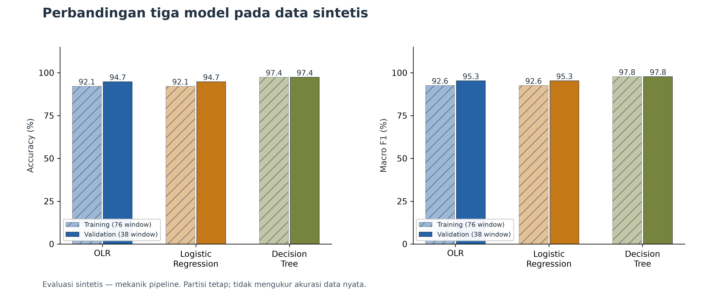

Bar berarsir menunjukkan training, bar penuh menunjukkan validation. Selisih keduanya hanya berlaku untuk fixture ini.
Skor tinggi atau selisih kecil belum membuktikan generalisasi ke sensor nyata maupun ketiadaan overfitting.
Validation ini merupakan fixture engineering yang telah dikenal pipeline, bukan tes independen yang baru dibuka.

| Model | Kelas | Precision | Recall | F1 | Support |
|---|---|---:|---:|---:|---:|
| OLR | Safe | 0.9130 | 1.0000 | 0.9545 | 21 |
| OLR | Monitor | 1.0000 | 0.7500 | 0.8571 | 8 |
| OLR | Caution | 1.0000 | 1.0000 | 1.0000 | 6 |
| OLR | Urgent | 1.0000 | 1.0000 | 1.0000 | 3 |
| Logistic Regression | Safe | 0.9130 | 1.0000 | 0.9545 | 21 |
| Logistic Regression | Monitor | 1.0000 | 0.7500 | 0.8571 | 8 |
| Logistic Regression | Caution | 1.0000 | 1.0000 | 1.0000 | 6 |
| Logistic Regression | Urgent | 1.0000 | 1.0000 | 1.0000 | 3 |
| Decision Tree | Safe | 0.9545 | 1.0000 | 0.9767 | 21 |
| Decision Tree | Monitor | 1.0000 | 0.8750 | 0.9333 | 8 |
| Decision Tree | Caution | 1.0000 | 1.0000 | 1.0000 | 6 |
| Decision Tree | Urgent | 1.0000 | 1.0000 | 1.0000 | 3 |

Tabel per kelas memperlihatkan ketidakseimbangan support; kelas dengan sedikit window memiliki estimasi yang rapuh.
Tidak dihitung confidence interval binomial seolah-olah semua window independen.

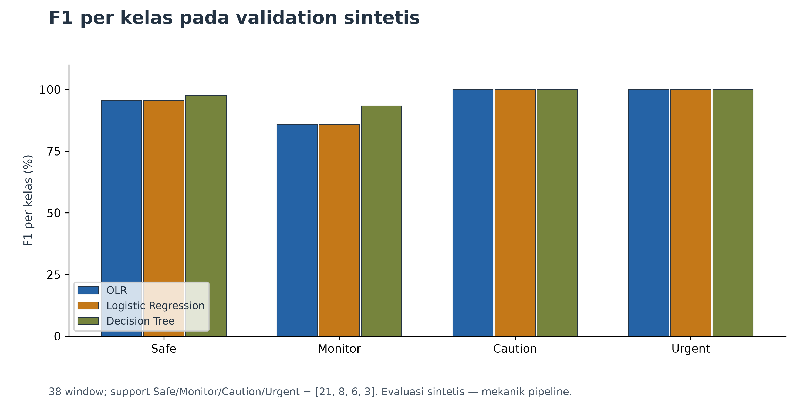

Perbandingan F1 membantu melihat kelas mana yang membatasi hasil agregat. Accuracy tidak menggantikan evaluasi per kelas.
Detail training dan validation tersedia pada [tabel per kelas](tables/per_class_metrics.csv).

## Confusion matrix memperlihatkan kesalahan yang sebenarnya dihitung

Setiap matrix berisi 38 window validation yang sama. Baris adalah label sintetis sebenarnya dan kolom adalah prediksi.
Jumlah diagonal dibagi total matrix sama dengan accuracy pada tabel; support sama dengan jumlah tiap baris.

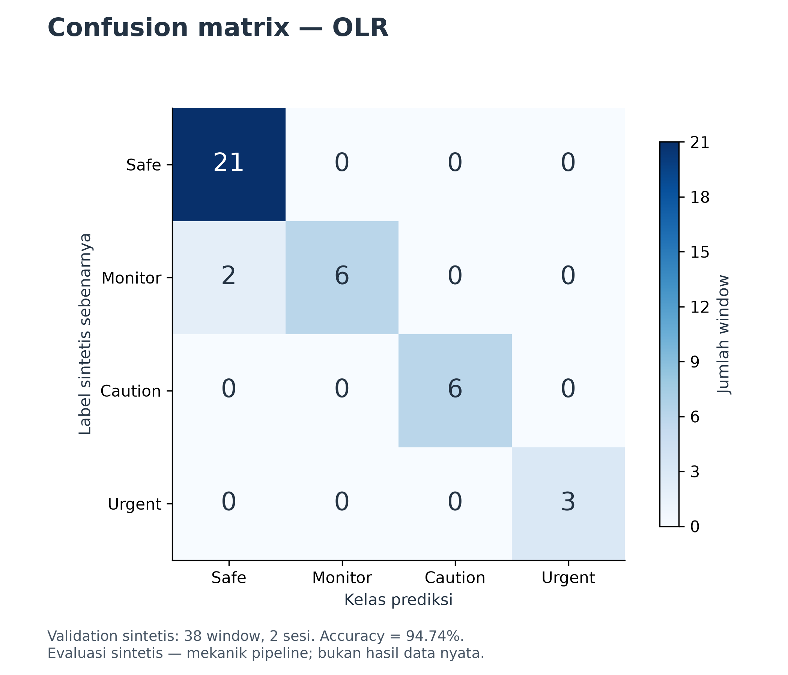

Matrix OLR menggunakan forward pass model bawaan yang hash-nya cocok dengan hasil reproduksi pipeline.
Kedua kesalahannya adalah label sintetis Monitor yang diprediksi Safe; recall Monitor 6/8 atau 75%.
Kesalahan di luar diagonal adalah ketidaksesuaian terhadap label sintetis, bukan kejadian pasien.

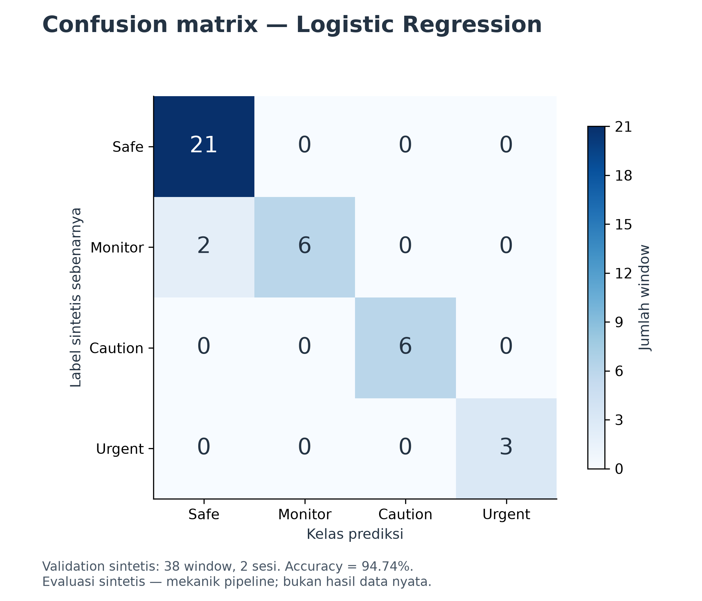

Logistic Regression memakai scaling yang di-fit hanya pada Development. Hasilnya menjadi pembanding dengan data dan label yang sama.

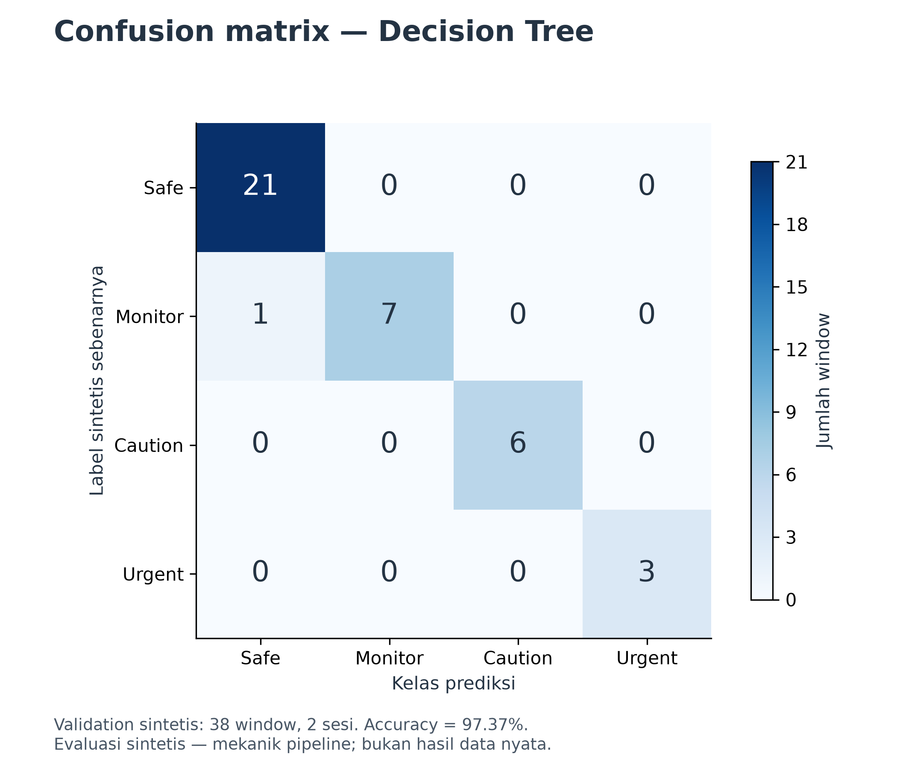

Decision Tree dibatasi kedalaman tiga dan minimum dua sampel per leaf sejak awal analisis. Hasil ini tidak mewakili konfigurasi optimal semua decision tree.

## Jejak OLR menggambarkan proses optimisasi yang direproduksi

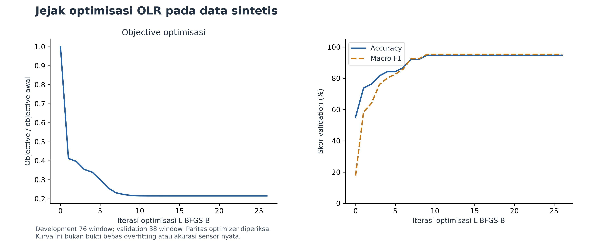

Kurva kiri menunjukkan objective relatif terhadap nilai awal, bukan neural-network loss. Kurva kanan menunjukkan skor validation
sepanjang iterasi L-BFGS-B; skor tidak digunakan untuk memilih checkpoint. Instrumentasi dijalankan ulang dan diperiksa terhadap
parameter/probabilitas/kelas model canonical sebelum grafik dibuat. Jumlah iterasi tercatat: 26.
Lihat [trace](tables/optimization_trace.csv) dan [paritas](checks/optimizer_parity.json). Tidak ada warning fitting yang tercatat.

## Semua sesi sensor nyata tetap tercakup

| Sesi | Skenario | Raw | Rentang waktu (s) | Parsial | Window |
|---|---|---:|---:|---:|---:|
| P001 | kering_diam | 2985 | 298.4 | 5 | 18 |
| P002 | kering_dengan_gerakan | 2717 | 271.6 | 7 | 16 |
| P003 | pengisian_kantong_bertahap | 3312 | 331.1 | 2 | 22 |
| P004-1 | kebocoran_bertahap | 1537 | 153.6 | 7 | 4 |
| P004-2 | kebocoran_bertahap | 1267 | 126.6 | 7 | 1 |
| P004-3 | kebocoran_bertahap | 1527 | 152.6 | 7 | 4 |
| P005-1 | kebocoran_mendadak | 1831 | 183.0 | 1 | 7 |
| P005-2 | kebocoran_mendadak | 1510 | 150.9 | 0 | 4 |
| P005-3 | kebocoran_mendadak | 1675 | 167.4 | 5 | 5 |
| P006 | uji_gangguan_sensor | 1126 | 112.5 | 6 | 0 |
| P007 | kantong_diisi_sampai_penuh | 2400 | 239.9 | 0 | 13 |

Rentang waktu adalah selisih timestamp relatif terakhir dan pertama, bukan tanggal kalender atau waktu menuju kebocoran.
CSV memiliki kolom `elapsed_ms`, sehingga grafik terhadap waktu relatif tetap dapat dibuat. Yang belum tersedia adalah
waktu kejadian pembanding terverifikasi untuk memasangkan sinyal dengan kondisi risiko sebenarnya.
Pemeriksaan menghasilkan 2,184 kelompok 1 Hz lengkap dan 94 window tanpa label.
Sebanyak 47 sampel akhir tidak membentuk kelompok lengkap berisi 10 sampel;
sampel tersebut tetap masuk statistik raw dan grafik, tetapi tidak masuk agregasi 1 Hz.

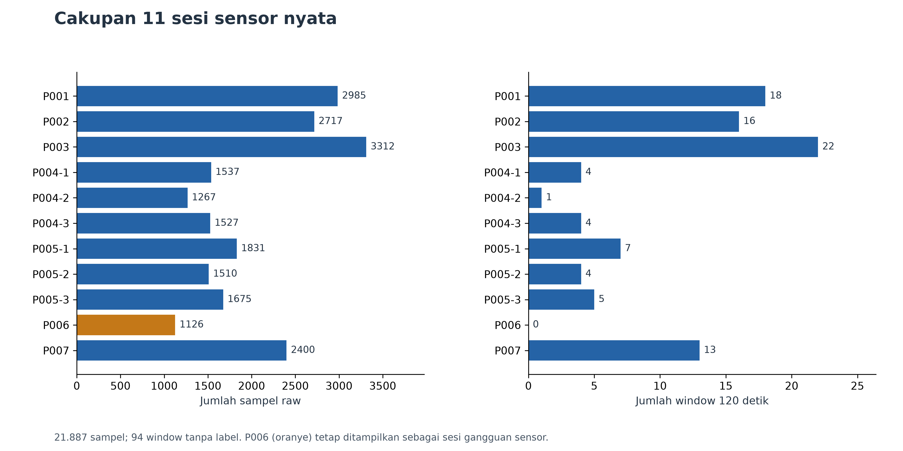

Panjang sesi dan jumlah window berbeda, sehingga pooled sample count tidak boleh dianggap jumlah eksperimen independen.
P006 tetap dianalisis sebagai gangguan sensor. Tabel [QC per sesi](tables/qc_sessions.csv) menyimpan interval dan status kanal.
Seluruh sesi lulus pemeriksaan struktur dengan interval tercatat 100 ms. Ini menunjukkan konsistensi struktur logger,
belum membuktikan keakuratan clock fisik atau mutu sensor. P006 memiliki 112 kelompok 1 Hz, sehingga tidak memenuhi panjang
window 120 detik dan menghasilkan nol window; seluruh 1.126 sampel raw-nya tetap tersedia.

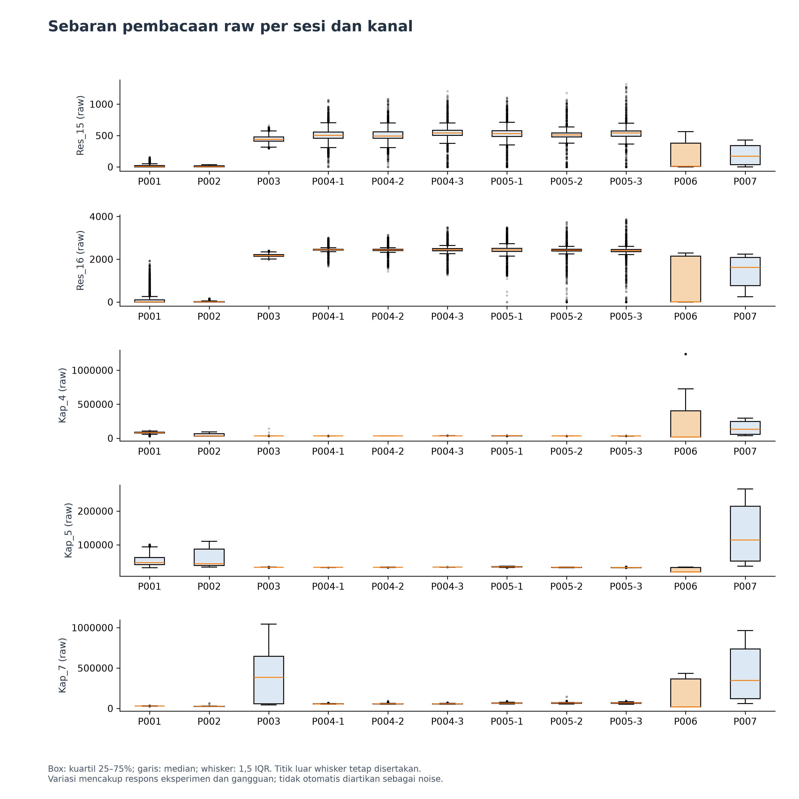

Boxplot memakai seluruh raw pada setiap sesi: kuartil dengan interpolasi linear, median, serta titik di luar 1,5 IQR.
Tidak ada penggantian outlier. Sebaran mencakup perubahan kondisi eksperimen; tanpa kondisi referensi terverifikasi,
seluruh variasi tidak dapat disebut noise. [Statistik lengkap](tables/real_channel_statistics.csv) mencatat minimum, maksimum, median, dan IQR.
Secara visual, P007 memperlihatkan kenaikan ketiga kanal kapasitif dan penurunan kedua kanal resistif sepanjang sesi.
P003 menunjukkan kenaikan besar pada Kap_7, sedangkan rentang kanal kapasitif lain berbeda. Pola ini adalah deskripsi kurva;
tanpa penanda kejadian dan besaran fisik pembanding, hubungan dengan volume atau onset kebocoran belum terverifikasi.
Satuan adalah angka raw logger, tidak dikonversi menjadi %RH, volume terkalibrasi, atau resistansi fisik.

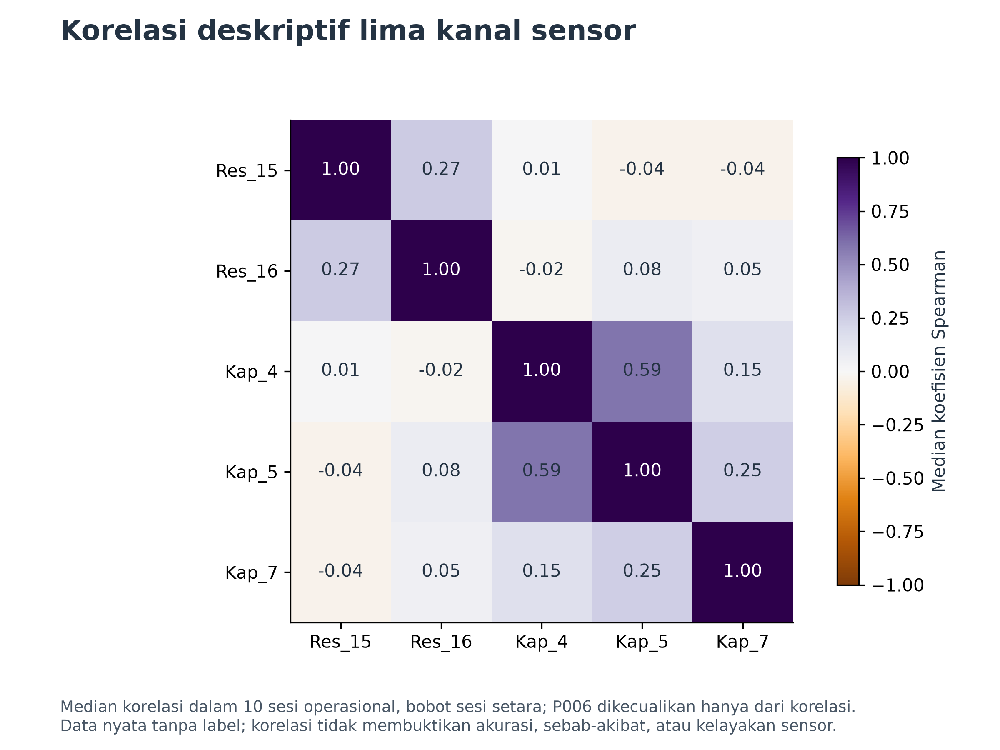

Korelasi Spearman dihitung dalam setiap sesi operasional, lalu diringkas dengan median agar sesi panjang tidak mendominasi.
P006 dikecualikan hanya dari ringkasan korelasi sesuai konfigurasi yang sudah ada. [IQR korelasi](tables/sensor_correlation_iqr.csv)
menyertakan variasi antarsesi. Korelasi tidak menetapkan kanal terbaik, kalibrasi valid, atau akurasi model.

### P006: gangguan sensor dipertahankan sebagai bukti

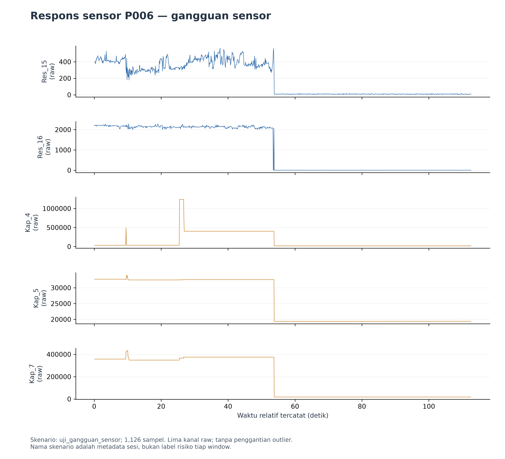

Grafik memperlihatkan kelima kanal P006 tanpa membuang pembacaan ekstrem. Nama skenario menandai tujuan sesi;
perubahan tajam beberapa kanal tampak sekitar detik ke-54 pada kurva. Waktu tersebut hanya pengamatan visual perubahan sinyal,
bukan timestamp kejadian gangguan yang telah dikonfirmasi.
tanpa waktu kejadian terverifikasi, grafik ini tidak dipakai menghitung sensitivitas deteksi gangguan.

### Grafik setiap sesi

Grafik berikut memuat raw lengkap, sumbu waktu relatif, dan lima kanal terpisah. Tinjau pola per sesi;
nama skenario tidak memberikan label risiko untuk setiap bagian kurva.

- [P001: kering_diam](figures/sensor_P001.png)
- [P002: kering_dengan_gerakan](figures/sensor_P002.png)
- [P003: pengisian_kantong_bertahap](figures/sensor_P003.png)
- [P004-1: kebocoran_bertahap](figures/sensor_P004-1.png)
- [P004-2: kebocoran_bertahap](figures/sensor_P004-2.png)
- [P004-3: kebocoran_bertahap](figures/sensor_P004-3.png)
- [P005-1: kebocoran_mendadak](figures/sensor_P005-1.png)
- [P005-2: kebocoran_mendadak](figures/sensor_P005-2.png)
- [P005-3: kebocoran_mendadak](figures/sensor_P005-3.png)
- [P006: uji_gangguan_sensor](figures/sensor_P006.png)
- [P007: kantong_diisi_sampai_penuh](figures/sensor_P007.png)

## Metode, pemisahan sumber bukti, dan jejak audit

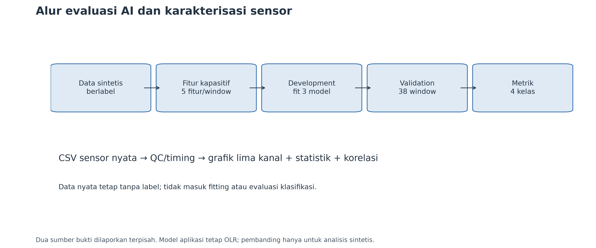

Data sintetis melewati generator v0.3 (seed 20260722), ekstraksi fitur, rulebook fixture, matrix, fitting, dan validation.
Scaler OLR/LR hanya melihat Development; Decision Tree memakai fitur asli. Parameter tetap: OLR alpha 1/max_iter 10000;
LR C 1/lbfgs/max_iter 10000; Tree gini/depth 3/min_leaf 2/seed 20260909. Tidak ada class weighting atau tuning validation.

Data nyata menggunakan median setiap 10 sampel lengkap, baseline provisional dari 20 detik awal, dan window 120 detik/stride 10 detik.
Baseline tersebut belum diverifikasi kering. Fitur pilot memakai delta_norm, sedangkan model memakai raw-minus-baseline;
fitur pilot tidak dimasukkan ke classifier dalam paket ini. [Audit pengeluaran data](tables/exclusion_audit.csv) dan
manifest matrix menyimpan alasan window sintetis tidak eligible: {"CENSORED_NO_SAFE_HORIZON": 11, "DUPLICATE_TIMESTAMP": 0, "FIELD_ARM_EXCLUDED": 0, "INVALID_CAP_QUALITY": 32, "PARTIAL_WINDOW": 12, "POST_LEAK": 24, "SUDDEN_ARM": 17, "TIMING_OUT_OF_TOLERANCE": 0}.

Commit AI: `5cd016370d6559ad2c61b2ebecb49c2b54fa5e91`. SHA-256 model: `ceb2922841431a38c274e0ebd5c350873a28a95f40a6f6aab2194a1603b93cef`.
Versi Python 3.12.3; dependensi: matplotlib 3.11.1, mord 0.7, numpy 2.2.6, scikit-learn 1.9.0, scipy 1.14.1.
[Inventaris hash input](tables/source_inventory.csv), [prediksi per window](tables/synthetic_predictions.csv),
[pemisahan kelompok](checks/group_separation.json), dan [pemeriksaan numerik](checks/analysis_checks.json) disertakan.

## Keterbatasan dan bentuk klaim yang dapat digunakan

| Pertanyaan | Status |
|---|---|
| Dapatkah model menghasilkan empat kelas dan dihitung metriknya pada fixture sintetis? | Ya, angka dan prediksi disertakan. |
| Apakah klasifikasi risiko sensor nyata sudah akurat? | Belum dapat dievaluasi: tidak tersedia ground truth. |
| Apakah ada pengukuran akurasi notifikasi atau early-warning lead time? | Tidak; waktu kejadian pembanding belum tersedia. |
| Apakah angka sintetis membuktikan target Final Test nyata? | Tidak; target tersebut tetap belum dievaluasi. |
| Apakah 317 unit/integration test sama dengan 317 eksperimen sensor? | Tidak; tes kode memeriksa perilaku implementasi. |

Tidak dibuat label dari nama skenario, urutan waktu sesi, tinggi-rendah kapasitansi, atau prediksi model sendiri.
Quality gate mencakup tes kode otomatis. Paket ini belum menguji firmware on-device atau integrasi end-to-end pada alat fisik.
Hasil sangat terbatas oleh fixture, sedikitnya sesi validation, window bertumpang tindih, dan belum adanya label nyata.

## Verifikasi dan tindakan berikutnya

- Quality gate repo: **PASS**. Detail: [log lengkap](logs/repository-quality-full.log).
- Hasil gate yang dicatat: 317 tes Python lulus (0 skip), Ruff lulus, Pyright 0 error/0 warning, build dan clean-wheel import lulus, 3 tes C++17 lulus, repository hygiene lulus.
- Reproduksi analisis ke direktori baru: **PASS**.
- Perbandingan numerik: 19 artefak identik;
  pemeriksaan independen memakai scikit-learn. Bukti disimpan dalam checks/reproduction.json setelah verifikasi.
- Perhitungan manual dari confusion matrix, identitas baris evaluasi, dan pengulangan fit pembanding diperiksa oleh script.
- Selesai: paket analisis dan tabel/grafik yang tercantum. Pemeriksaan visual dicatat terpisah dalam berkas QA.
- Belum dilakukan: evaluasi akurasi nyata, notifikasi/lead time, firmware fisik, dan integrasi aplikasi pada alat fisik.
- Perlu persetujuan: perubahan keputusan model atau publikasi eksternal; tidak diperlukan untuk membaca paket lokal ini.
- Masalah/risiko: generalisasi ke data nyata belum diketahui; baseline/kualitas sensor masih provisional.

Gunakan [bahan konsultasi](bahan-konsultasi.md) untuk menjelaskan hasil dan batasannya. Pertanyaan yang masih perlu dibahas
dengan pembimbing adalah apakah pembuktian prototipe melalui mekanik model dan karakterisasi sensor ini sudah disajikan dengan tepat,
serta bagaimana menyatakan target evaluasi nyata yang belum tercapai. Tidak ada rencana pengambilan data tambahan dalam batch ini.
